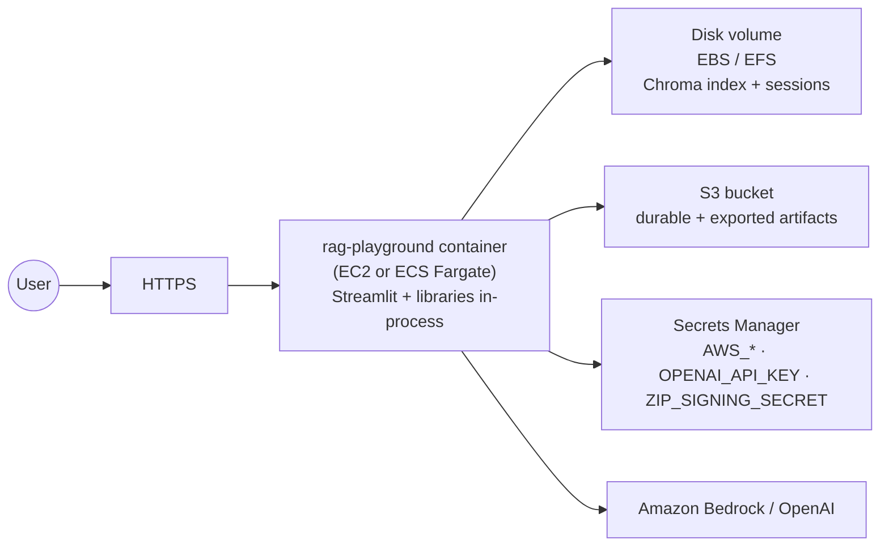

# AWS Deployment Runbook (hands-on, beginner-friendly)

← Back to [README](../README.md) · concepts & architecture: [CLOUD_DEPLOYMENT.md](CLOUD_DEPLOYMENT.md) · security: [SECURITY.md](SECURITY.md)

This is the **how-to**. [CLOUD_DEPLOYMENT.md](CLOUD_DEPLOYMENT.md) explains *why* the
architecture is shaped the way it is (and validates the three-tier split); this page gives
**exact, copy-pasteable steps** to get `rag-playground` running on AWS, written for someone
new to AWS. Work top-to-bottom.

> 💡 **New to AWS? Read this first.** You are renting three kinds of thing: **compute**
> (something that runs the app — EC2 or ECS/Fargate), **storage** (durable files — S3 and a
> disk volume), and **secrets** (API keys — Secrets Manager). Everything below is just
> wiring those together. **You will be charged** while resources run — see
> [§ Costs & cleanup](#costs--cleanup) and delete things when you are done.

## Contents

- [What you'll build](#what-youll-build)
- [Prerequisites](#prerequisites)
- [Step 0 — test the whole stack locally first](#step-0--test-the-whole-stack-locally-first)
- [Tier 1 — get it live (pick one)](#tier-1--get-it-live-pick-one)
  - [Option A — one EC2 instance (gentlest)](#option-a--one-ec2-instance-gentlest)
  - [Option B — ECS Fargate (no servers to manage)](#option-b--ecs-fargate-no-servers-to-manage)
- [Storage: S3 + a volume for the index](#storage-s3--a-volume-for-the-index)
- [Secrets: never bake keys into an image](#secrets-never-bake-keys-into-an-image)
- [Tier 2 — split frontend and backend (scale-out)](#tier-2--split-frontend-and-backend-scale-out)
- [Mapping to your "3 frontend / 2 backend / 1 storage" idea](#mapping-to-your-3-frontend--2-backend--1-storage-idea)
- [Costs & cleanup](#costs--cleanup)
- [Security checklist](#security-checklist)
- [Troubleshooting](#troubleshooting)

---

## What you'll build

**Tier 1 (this guide's main goal):** the whole app in **one container** on AWS, with durable
files in **S3** and the vector index on a **disk volume**. This is the fastest way to get a
working, shareable URL.



**Tier 2 (later):** split the UI from the compute so they scale independently — covered in
[§ Tier 2](#tier-2--split-frontend-and-backend-scale-out). The Tier-1/Tier-2 reference
diagrams live in [CLOUD_DEPLOYMENT.md § 4](CLOUD_DEPLOYMENT.md#4-reference-architecture).

## Prerequisites

1. **An AWS account** (the [free tier](https://aws.amazon.com/free/) covers most of Tier 1's
   EC2 option for 12 months).
2. **AWS CLI v2** installed and configured: `aws configure` (set your access key, secret, and
   default region, e.g. `ap-southeast-1`). Verify with `aws sts get-caller-identity`.
3. **Docker** installed locally (to build the image).
4. This repo cloned locally.

Throughout, replace the placeholders: `<ACCOUNT_ID>` (12 digits), `<REGION>` (e.g.
`ap-southeast-1`), `<BUCKET>` (a globally-unique S3 name).

## Step 0 — test the whole stack locally first

Before touching AWS, prove the container works with the bundled
[`docker-compose.yml`](../docker-compose.yml) (frontend + backend + a MinIO object store that
behaves like S3):

```bash
docker compose up frontend      # Tier 1: just the app in one container → http://localhost:8501
# or the full split to rehearse Tier 2:
docker compose up               # frontend + backend + MinIO (S3-compatible)
```

If that works, AWS is mostly "the same container, somewhere else."

## Tier 1 — get it live (pick one)

Both options run the **same** image built from the repo's
[`Dockerfile`](../Dockerfile) (crawl-capable: it bundles Chromium + Tesseract and needs a
large `/dev/shm`). Start with **Option A** if you are new; move to **Option B** when you want
AWS to manage the servers for you.

### Option A — one EC2 instance (gentlest)

One virtual machine, running Docker. Easiest to picture, cheapest to start.

1. **Launch an instance.** EC2 → Launch instance → Amazon Linux 2023, size `t3.large` (crawling
   needs memory), 30 GB disk. Create/download a key pair. In the security group, allow inbound
   **22** (SSH, your IP only) and **8501** (the app).
2. **Connect and install Docker:**
   ```bash
   ssh -i your-key.pem ec2-user@<PUBLIC_IP>
   sudo dnf update -y && sudo dnf install -y docker git
   sudo systemctl enable --now docker
   sudo usermod -aG docker ec2-user   # log out/in so `docker` works without sudo
   ```
3. **Get the image onto the box.** Either `git clone` the repo and `docker build -t rag-playground .`,
   or pull from ECR (see [Option B step 1](#option-b--ecs-fargate-no-servers-to-manage)).
4. **Run it** with a persistent volume for the index/sessions and your region for Bedrock:
   ```bash
   docker run -d --restart unless-stopped \
     --shm-size=2g -p 8501:8501 \
     -v /home/ec2-user/data:/data/sessions \
     -e SESSIONS_ROOT=/data/sessions \
     -e AWS_REGION=<REGION> \
     --name rag rag-playground
   ```
   The `-v` maps a host directory (persisted on the instance's EBS disk) so your Chroma index
   and session files survive restarts.
5. **Open** `http://<PUBLIC_IP>:8501`. 🎉
6. **Add HTTPS** (recommended before sharing): put the instance behind an **Application Load
   Balancer** with an ACM certificate, or run Caddy/Nginx on the box for TLS. Keep port 8501
   private once the LB terminates TLS.

> For real durability and credentials, add [S3](#storage-s3--a-volume-for-the-index) and
> [Secrets Manager](#secrets-never-bake-keys-into-an-image) (next sections) instead of baking
> keys into the `docker run` line.

### Option B — ECS Fargate (no servers to manage)

Fargate runs your container without you managing a VM. More moving parts, but the standard
production shape.

1. **Create a registry and push the image** (ECR):
   ```bash
   aws ecr create-repository --repository-name rag-playground --region <REGION>
   aws ecr get-login-password --region <REGION> \
     | docker login --username AWS --password-stdin <ACCOUNT_ID>.dkr.ecr.<REGION>.amazonaws.com
   docker build -t rag-playground .
   docker tag rag-playground <ACCOUNT_ID>.dkr.ecr.<REGION>.amazonaws.com/rag-playground:latest
   docker push <ACCOUNT_ID>.dkr.ecr.<REGION>.amazonaws.com/rag-playground:latest
   ```
2. **Create an ECS cluster** (Fargate): ECS console → Create cluster → *Networking only*.
3. **Create a task definition** (Fargate, 2 vCPU / 4+ GB). Container image = the ECR URI above,
   port **8501**. Add environment variables (`SESSIONS_ROOT=/mnt/data/sessions`, `AWS_REGION`,
   `STORAGE_BACKEND=s3`, `STORAGE_S3_BUCKET=<BUCKET>`) and the secrets (next section). **Mount an
   EFS volume** at `/mnt/data` so the Chroma index persists (Fargate's own disk is ephemeral).
4. **Create a service** with an **Application Load Balancer** (HTTPS via an ACM cert) targeting
   port 8501, in **private subnets** with the ALB public.
5. **Verify** at the ALB's HTTPS URL.

> **Crawling (Step 1) on Fargate** needs the crawl-capable image and ~2 GB shared memory;
> Fargate gives tasks enough `/dev/shm` by default, but a very heavy crawl may prefer the EC2
> option or a dedicated worker.

## Storage: S3 + a volume for the index

Two different needs, two different stores (this is the one AWS subtlety worth understanding):

| What | Where | How |
| --- | --- | --- |
| **Durable artifacts** — crawl Markdown, exported zips, histories | **S3** | Set `STORAGE_BACKEND=s3` + `STORAGE_S3_BUCKET` (+ optional `STORAGE_S3_PREFIX`). The app uses the opt-in [`artifact_store_s3`](../src/artifact_store_s3/README.md) backend. |
| **The vector index** — ChromaDB (SQLite + files) | **A disk volume** (EBS on EC2, **EFS** on Fargate) | ChromaDB **cannot be pointed directly at S3**; mount a volume and set `SESSIONS_ROOT` to it. |

```bash
aws s3 mb s3://<BUCKET> --region <REGION>          # create the bucket
# then run the container with:
#   -e STORAGE_BACKEND=s3 -e STORAGE_S3_BUCKET=<BUCKET> -e AWS_REGION=<REGION>
```

Grant the instance/task an **IAM role** with least-privilege access to just that bucket (and
let the role — not keys — provide AWS credentials). See
[CLOUD_DEPLOYMENT.md § 5](CLOUD_DEPLOYMENT.md#5-storage-abstraction-design-b2b4) for the design.

## Secrets: never bake keys into an image

Store `AWS_*` (if not using a role), `OPENAI_API_KEY`, and **`ZIP_SIGNING_SECRET`** in AWS
Secrets Manager (or SSM Parameter Store), and inject them as environment variables at runtime.

```bash
aws secretsmanager create-secret --name rag/openai --secret-string '{"OPENAI_API_KEY":"sk-..."}'
aws secretsmanager create-secret --name rag/zip --secret-string '{"ZIP_SIGNING_SECRET":"<long-random-string>"}'
```

- In an **ECS task definition**, reference them under `secrets:` so they arrive as env vars.
- On **EC2**, fetch them at boot (e.g. `aws secretsmanager get-secret-value`) and export before
  `docker run`.
- `ZIP_SIGNING_SECRET` is **dual-purpose** (it signs downloadable zips *and* derives the
  credential-encryption key), so you **must** override the shipped development default per
  deployment — the app logs a startup warning while the default is in use. See
  [SECURITY.md](SECURITY.md).

## Tier 2 — split frontend and backend (scale-out)

Tier 2 runs the **UI** and the **compute** as separate services so they scale independently —
this is the "3 frontend / 2 backend" shape. It becomes fully useful once the app's HTTP offload
covers every step (`BACKEND_MODE=http`); see the roadmap in
[CLOUD_DEPLOYMENT.md § 9](CLOUD_DEPLOYMENT.md#9-staged-roadmap).

1. **Deploy the backend** as its own service from [`Dockerfile.backend`](../Dockerfile.backend)
   (query-only, no browser — stays small) on ECS Fargate, reading `ARTIFACTS_ROOT` from the
   shared store.
2. **Point the frontend at it:** set `BACKEND_MODE=http` and `BACKEND_URL=https://<backend-host>`
   on the frontend. The frontend then calls the backend over HTTP instead of running compute in-process.
3. **Host the UI cheaply (optional):** keep the Streamlit UI on **Streamlit Community Cloud**
   (it auto-deploys from GitHub — see [CICD_GITHUB_ACTIONS.md](CICD_GITHUB_ACTIONS.md)) and set
   `BACKEND_URL` to your AWS backend. The UI stays light; AWS does the heavy lifting. **A public
   backend must be authenticated** — set `BACKEND_AUTH_TOKEN` (the same value on the backend and
   the frontend) so every route requires an `X-Backend-Token` header, and still keep it behind
   the ALB; never expose it open.
4. **Scale-out needs shared state:** multiple frontend instances must share session/conversation
   state and jobs (a distributed queue + a state DB) — the Tier-2 future items in
   [CLOUD_DEPLOYMENT.md § 4](CLOUD_DEPLOYMENT.md#4-reference-architecture).

## Mapping to your "3 frontend / 2 backend / 1 storage" idea

Your instinct is sound and is exactly Tier 2:

| Your node | AWS shape |
| --- | --- |
| 3 × frontend | 3 Streamlit tasks behind one ALB (or Streamlit Community Cloud instances) with `BACKEND_MODE=http` |
| 2 × backend | 2 FastAPI/Fargate tasks behind an internal ALB, auto-scaled |
| 1 × storage | **S3** (durable artifacts) + **EFS** (shared Chroma index) — "storage" is managed services, not a node you run |

One nuance: "storage" on AWS is **managed services** (S3/EFS), not a server you operate — so you
don't run a storage "node," you just point the others at S3/EFS.

## Costs & cleanup

- **Biggest costs:** the compute (EC2/Fargate running 24/7), the ALB (~hourly), and NAT/egress.
  S3 and Secrets Manager are cheap at this scale; LLM calls bill separately (Bedrock/OpenAI).
- **Stop paying** when experimenting: `docker stop rag` and **stop/terminate the EC2 instance**,
  or set the ECS service desired count to 0. Delete the ALB, EFS, and ECR images you don't need.
- Tear down everything with: terminate EC2 / delete ECS service + cluster, `aws s3 rb
  s3://<BUCKET> --force`, delete the ALB, EFS, ECR repo, and the secrets.

## Security checklist

Full audit in [SECURITY.md](SECURITY.md); the deployment essentials:

- Secrets in Secrets Manager/SSM, injected as env vars — **never** in the image or git.
- Override `ZIP_SIGNING_SECRET` per deployment.
- Terminate **TLS at the ALB**; keep container ports (8501/8000) private.
- Least-privilege **IAM roles** for S3/EFS; no long-lived keys on the box when a role works.
- For shared/multi-tenant crawl, enable the crawler's SSRF guard (`BLOCK_PRIVATE_NETWORKS=true`
  on the backend) **and** restrict **network egress** (deny RFC1918/link-local/metadata ranges)
  as defense in depth.
- A public Tier-2 backend **must** require auth — set `BACKEND_AUTH_TOKEN` on the backend and
  frontend, and leave `ALLOW_PAGE_SCRIPTS` unset. See
  [SECURITY.md](SECURITY.md#networked-backend-hardening).

## Troubleshooting

- **App starts but crawling crashes** → `/dev/shm` too small; ensure `--shm-size=2g` (EC2) or
  enough task memory (Fargate).
- **`SSL: CERTIFICATE_VERIFY_FAILED`** → a TLS-intercepting proxy; provide a correct CA bundle in
  the container environment rather than disabling verification.
- **Semantic search over an imported sample fails** → the bundled index embeds with Amazon Titan,
  so the task/instance role needs Bedrock access in `AWS_REGION`.
- **Index disappears after a redeploy** → it was on ephemeral disk; mount EBS/EFS and point
  `SESSIONS_ROOT` at it.

---

See also: [CLOUD_DEPLOYMENT.md](CLOUD_DEPLOYMENT.md) (architecture & readiness) ·
[CICD_GITHUB_ACTIONS.md](CICD_GITHUB_ACTIONS.md) (automate the build/deploy) ·
[CONFIGURATION.md](CONFIGURATION.md) (every setting).
