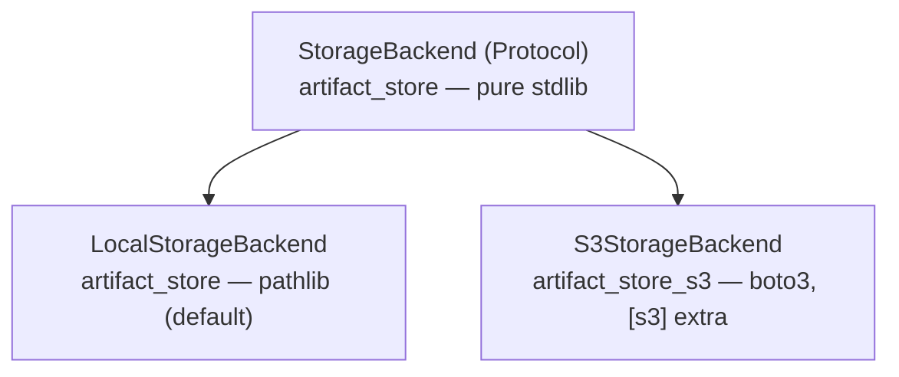

# artifact_store_s3

Amazon S3 storage backend for [`artifact_store`](../artifact_store/README.md) — an
**opt-in** `[s3]` extra. It is deliberately kept *out* of the pure `artifact_store`
foundation so that package never depends on `boto3`; install it only when you want
session artifacts to live in an S3 bucket instead of local disk.



## What it does

`S3StorageBackend` implements the same `artifact_store.StorageBackend` interface as the
default `LocalStorageBackend` (`exists` / `is_dir` / `read_bytes` / `write_bytes` /
`iterdir` / `mtime` / `remove_tree`), mapping each path to an object key (its POSIX
form, under an optional prefix) so a local session tree mirrors 1:1 into a bucket.

- **`boto3` is imported lazily** and the S3 client is **injectable**, so this module loads
  (and is unit-testable with a mocked client) without the `[s3]` extra installed and with
  **no real AWS calls** in tests.
- Works with any S3-compatible store (AWS S3, MinIO, LocalStack).

## Use it

```bash
pip install -e ".[s3]"
```

```python
from artifact_store_s3 import S3StorageBackend

backend = S3StorageBackend(bucket="my-bucket", prefix="rag-playground")
backend.write_bytes(Path("sessions/abc/manifest.json"), b"...")
```

In the Streamlit app, select it with configuration instead of constructing it directly:
`STORAGE_BACKEND=s3` plus `STORAGE_S3_BUCKET` / `STORAGE_S3_PREFIX` (see
[CONFIGURATION.md](../../docs/CONFIGURATION.md)).

## Where it fits

This is the storage tier of the cloud split. See the storage-abstraction design and the
staged roadmap in [CLOUD_DEPLOYMENT.md](../../docs/CLOUD_DEPLOYMENT.md#5-storage-abstraction-design-b2b4),
and [AWS_DEPLOYMENT.md](../../docs/AWS_DEPLOYMENT.md) for a hands-on S3 setup.
